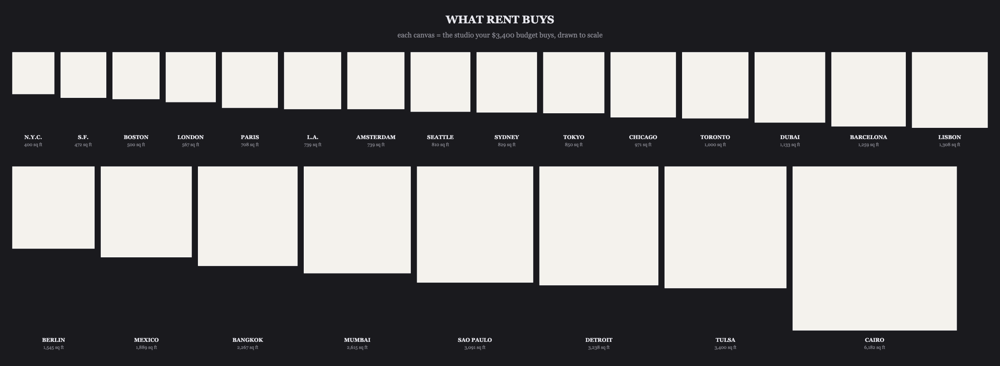
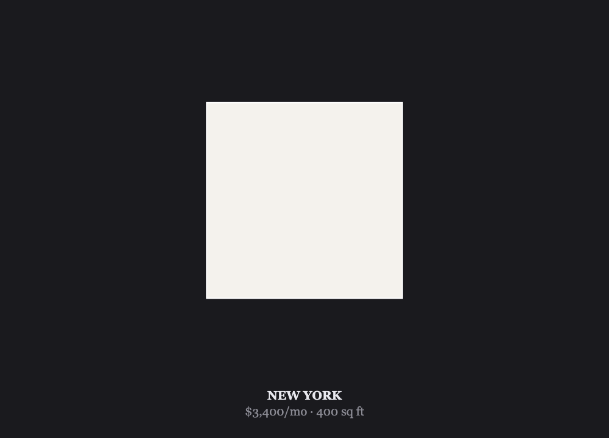
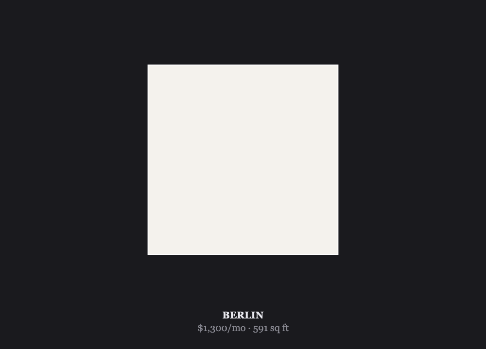
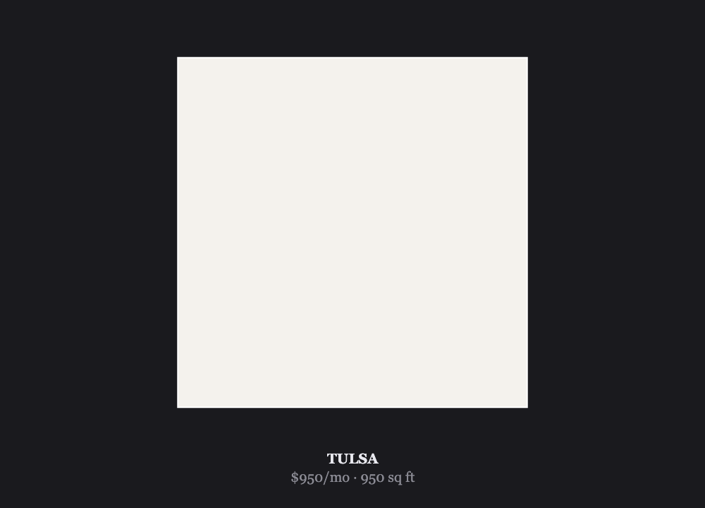
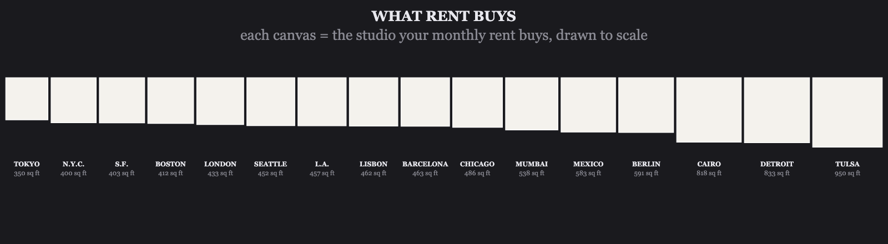
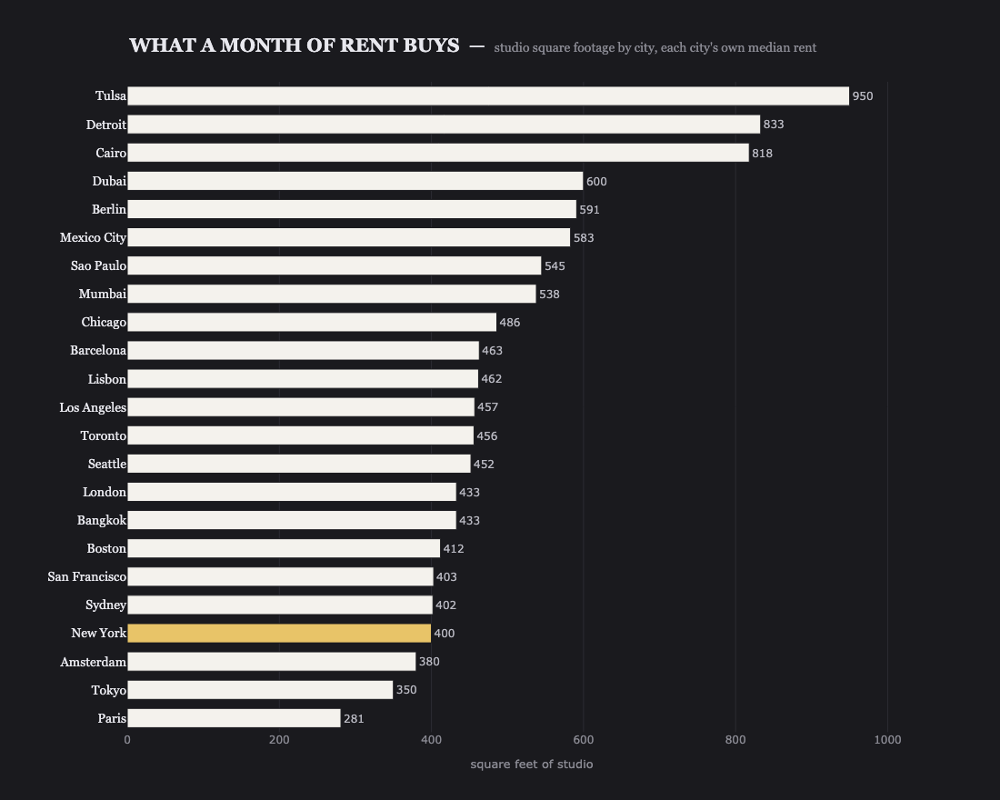
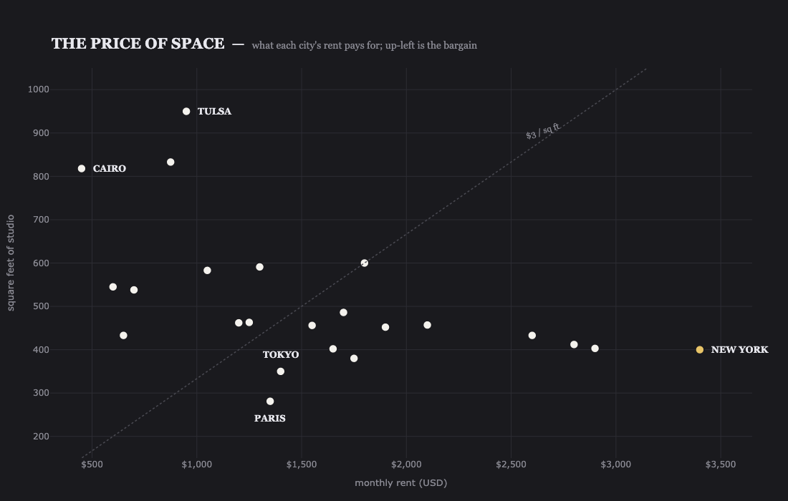

# Rent = Canvas

**What your rent buys, drawn to scale.**

Every white square below is a studio apartment — its area is exactly the
square footage a month of rent buys in that city. New York's $3,400 is a
postage stamp. Cairo's $450 is a full mural. Same medium, wildly different
canvas.

<p align="center">
  
</p>

*One $3,400 budget — New York's median studio rent — spent in every city.
Each canvas is true-area scaled: side length grows with √sqft.*

---

## The art

Rent is abstract until you can hang it on a wall. This project treats
monthly rent as a **budget for canvas**: divide the dollars by the local
price per square foot, and you get the size of the blank rectangle you're
paying for. The bigger the rent, the smaller the canvas. The cheaper the
city, the more wall you get.

No photos, no floor plans — just white rectangles on a dark wall, like
works in a gallery. The geometry does the arguing.

| City | Rent | Canvas |
|:-----|-----:|-------:|
| Paris | $1,350/mo | 281 sq ft |
| Tokyo | $1,400/mo | 350 sq ft |
| New York | $3,400/mo | 400 sq ft |
| Berlin | $1,300/mo | 591 sq ft |
| Tulsa | $950/mo | 950 sq ft |

<p align="center">
  
  
  
</p>

<p align="center"><em>New York · Berlin · Tulsa — each at its own local rent.</em></p>

## How it works

```
sqft = monthly_rent_usd / price_per_sqft_usd
side = K × √sqft        # true-area scaling, shared K across every render
```

- **Data** — `data/rents.csv` holds 23 cities: median studio/1-bed
  asking rent in USD and an indicative price per square foot, from
  Paris (281 sq ft) to Tulsa (950 sq ft).
- **Render** — `rent_canvas.py` draws each city as a Plotly rectangle on a
  gallery-dark wall. One shared pixel scale (`K`) means every image is
  directly comparable: Tokyo's stamp is a stamp in every frame.
- **Two readings** — the default wall uses *each city's own rent* (what
  locals actually get). Pass `--budget 3400` to hold dollars fixed and
  move cities instead.

## Usage

```bash
pip install -r requirements.txt

python rent_canvas.py                    # ranked table of what rent buys
python rent_canvas.py "New York"         # single canvas in the browser
python rent_canvas.py "Berlin" --budget 3400   # $3,400 spent in Berlin
python rent_canvas.py --wall             # full gallery wall
python rent_canvas.py --bars             # every city ranked as bars
python rent_canvas.py --scatter          # rent vs. space scatter
python rent_canvas.py --export images/   # PNGs (what README uses)
```

The `--export` pass writes one canvas per city, both walls, and both
charts:

<p align="center">
  
</p>

*Each city at its own local rent — what a resident actually gets for the
price they pay. Tokyo, paying more than Berlin, gets less than half the canvas.*

## By the numbers

The same data, argued two other ways — still white on the gallery dark,
still drawn to scale.

<p align="center">
  
</p>

*Tulsa hands over 950 sq ft for $950; Paris hands over 281 for $1,350.
New York — flagged gold — pays the most for one of the smallest
canvases: $8.50 per square foot, roughly fifteen times Cairo's $0.55.*

<p align="center">
  
</p>

*Both variables in one frame. Bargains float up-left (Cairo, Tulsa);
the expensive trap sits down-right. The dotted rule is $3/sq ft —
everything below it is paying more than that for air.*

### Tests

```bash
pip install -r requirements-dev.txt
pytest
```

## Data & caveats

Figures in `data/rents.csv` are **indicative late-2025 asking rents** for
studios / 1-bedrooms in central-ish neighborhoods, in USD, with rounded
price-per-sqft estimates. They are meant for comparison, not for lease
negotiation. Real rents vary by neighborhood, building, and mood of the
market. Currencies are flattened to USD for a single wall.

## Layout

```
rent_canvas.py            # load → sqft → draw → export (~410 lines)
data/rents.csv            # city, monthly_rent_usd, price_per_sqft_usd
images/                   # exported PNGs used in this README
test_rent_canvas.py       # math sanity checks
requirements-dev.txt      # pytest, for the checks above
```

## License

MIT
